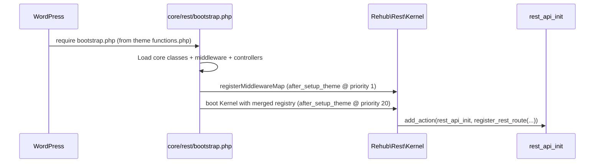

# Rehub Custom REST Framework — Developer Guide

> **Audience:** WordPress/PHP developers integrating REST endpoints into the Rehub theme
> **Scope:** Architecture, routing, middleware, controllers, validation, responses, caching/throttling, security, and examples
> **Status:** Stable (production-ready)

---

## Table of Contents

- [Rehub Custom REST Framework — Developer Guide](#rehub-custom-rest-framework--developer-guide)
  - [Table of Contents](#table-of-contents)
  - [Overview](#overview)
  - [Key Features](#key-features)
  - [Folder Structure](#folder-structure)
  - [Boot Sequence](#boot-sequence)
  - [Routing](#routing)
  - [Controllers](#controllers)
  - [Validation](#validation)
  - [Responses](#responses)
  - [Middleware](#middleware)
  - [Caching \& Throttling](#caching--throttling)
    - [Caching (GET only)](#caching-get-only)
    - [Throttling](#throttling)
  - [Security](#security)
  - [Telemetry \& Logging](#telemetry--logging)
  - [Configuration](#configuration)
  - [Examples](#examples)
    - [1) A basic read-only route (cached)](#1-a-basic-read-only-route-cached)
    - [2) Authenticated write route](#2-authenticated-write-route)
  - [Troubleshooting](#troubleshooting)
  - [Testing Tips](#testing-tips)
  - [Versioning \& Maintenance](#versioning--maintenance)
  - [Appendix — Minimal Controller Template](#appendix--minimal-controller-template)

---

## Overview

This module provides a **Laravel-like REST layer** on top of WordPress’ REST API, tailored for the Rehub theme. It standardizes:

* **Route definition** with groups, prefixes, and middleware.
* **Controller** abstraction with `authorize()`, `rules()`, `messages()`, and action methods.
* **Request validation** with simple, explicit rules.
* **Response helpers** (`ok`, `created`, `error`, `paginate`).
* **Middleware pipeline** (throttle, cache, ETag, CORS, auth, etc.).

The result: clean, consistent, and testable REST endpoints without scattering logic.

---

## Key Features

* ✅ **Declarative routes** (`core/rest/routes.php`) with groups and per-route middleware
* ✅ **Middleware aliases** registered once, re-used everywhere
* ✅ **Validation** rules (required, string, int, boolean, numeric, min/max, in, regex, slug)
* ✅ **Global and route-level caching** & **rate limiting**
* ✅ **Security**: cookie-based auth, nonce, JWT, app passwords, HMAC signatures
* ✅ **Observability** via lightweight telemetry
* ✅ **Error-safe bootstrapping** and defensive defaults

---

## Folder Structure

```
core/rest/
├─ bootstrap.php              # Bootstraps the module (load classes, register aliases, boot Kernel)
├─ routes.php                 # Registry: groups + routes + (optional) middlewareMap overrides
├─ Kernel.php                 # Registers routes with WP and runs middleware + controller dispatch
├─ Router.php                 # Group helpers (internal); Kernel uses the registry array
├─ Controller.php             # Base controller (authorize/rules/messages + helpers)
├─ RequestValidator.php       # Validation engine
├─ Response.php               # Response helpers (ok, error, paginate)
├─ helpers.php                # General helpers (params, parsing)
├─ Support.php                # Slug/identity/time utils
├─ Support/Http.php           # Header utilities (safe getter)
├─ Middleware/
│  ├─ AuthCookie.php
│  ├─ AuthNonce.php
│  ├─ AuthApp.php
│  ├─ AuthJwt.php
│  ├─ Throttle.php
│  ├─ Cache.php
│  ├─ Etag.php
│  ├─ Telemetry.php
│  └─ ... (IpAllow, Capability, SignatureHmac, Maintenance, Cors)
└─ Controllers/
   ├─ TermsController.php
   ├─ ExpertsController.php
   ├─ CoursesController.php
   ├─ WebinarsController.php
   ├─ WebinarJoinController.php
   ├─ PurchasedLearningController.php
   └─ CourseProgressController.php (optional)
```

---

## Boot Sequence



**Important:** `bootstrap.php` registers **middleware aliases first**, then boots the Kernel. This ensures routes can resolve aliases like `throttle`, `cache`, etc.

---

## Routing

Define routes and groups in `core/rest/routes.php`. A **group** provides a `prefix` and shared `middleware`:

```php
return [
  'groups' => [
    'public' => [
      'prefix'     => 'rehub/v1',
      'middleware' => [
        'telemetry',
        'throttle:60,1', // rate-limit BEFORE cache
        'etag',
        'cache:120',
        // 'cors',
      ],
    ],
  ],
  'routes' => [
    [
      'namespace'  => 'rehub/v1',
      'route'      => '/courses/(?P<id>\d+)',
      'methods'    => 'GET',
      'controller' => \Rehub\Rest\Controllers\CoursesController::class,
      'action'     => 'show',
      'group'      => 'public',
      'middleware' => ['throttle:10,1'], // per-route override/extra
      'args'       => [
        'id' => ['sanitize_callback' => 'absint'],
      ],
    ],
  ],
];
```

**Notes**

* `group` is optional but recommended for consistent middleware.
* `middleware` on a route appends to group middleware (group runs first).
* Always pass **strings** in the `middleware` array (do not nest arrays).

---

## Controllers

Extend `Rehub\Rest\Controller` and implement your actions:

```php
final class CoursesController extends \Rehub\Rest\Controller
{
    public function authorize(\WP_REST_Request $r): bool|\WP_REST_Response
    {
        // Public example: return true; or enforce auth and return Response::error(...) if needed.
        return true;
    }

    public function rules(): array
    {
        // Optional default rules; action-specific rules can live inside the action.
        return [];
    }

    public function messages(): array
    {
        return ['id.int' => 'Invalid course id.'];
    }

    public function show(\WP_REST_Request $r)
    {
        $id = (int) $r->get_param('id');
        // Query WP/Meta/ACF/etc.
        $data = [
            'id'    => $id,
            'title' => get_the_title($id),
        ];
        return $this->ok(['success' => true, 'data' => $data]);
    }
}
```

---

## Validation

Use `RequestValidator` for simple declarative rules:

Supported rules:

* `required`
* `string`, `int`, `boolean`, `numeric`
* `min:x`, `max:x` (numeric value or string length)
* `in:a,b,c`
* `regex:/^...$/`
* `slug` (use `normalize_slug()`; enable in your controller logic)

Example inside a controller action:

```php
public function index(\WP_REST_Request $r)
{
    $rules = [
        'per_page' => ['sometimes','int','min:1','max:50'],
        'filter'   => ['sometimes','string','min:1','max:40'],
        'type'     => ['sometimes','string','in:course,webinar'],
    ];

    $messages = [
        'per_page.int' => 'per_page must be integer.',
        'type.in'      => 'type must be one of: course, webinar.',
    ];

    $validator = new \Rehub\Rest\RequestValidator($rules, $messages);
    if (! $validator->passes($r)) {
        return \Rehub\Rest\Response::error('Validation failed.', 422, [
            'errors' => $validator->toErrorResponse(),
        ]);
    }

    // Proceed...
}
```

> Tip: If you want to normalize slugs, call `\Rehub\Rest\normalize_slug($value)` in your action or wire a `slug` rule branch.

---

## Responses

Use `Rehub\Rest\Response` helpers:

* `Response::ok(array $data = [], int $status = 200, array $headers = [])`
* `Response::created(array $data = [], array $headers = [])`
* `Response::error(string $message, int $status = 400, array $extra = [])`
* `Response::paginate(array $items, int $total, int $page, int $perPage, array $extra = [])`

Example:

```php
return \Rehub\Rest\Response::ok([
    'success' => true,
    'items'   => $items,
]);
```

---

## Middleware

Middleware are registered by **alias** and instantiated per-use:

Common aliases:

* `telemetry` — logs method/route/status/time to `error_log`.
* `throttle:MAX,MINUTES` — rate limit by client identity (user id or IP).
* `etag` — adds ETag for GET; supports 304 on If-None-Match.
* `cache:SECONDS` — transient cache for GET (public endpoints).
  *Be careful with logged-in responses; avoid caching personal data.*
* `cors` — (if available) sets CORS headers.
* `auth:cookie` — requires logged-in WP user (optionally capability).
* `auth:nonce` — requires valid `X-WP-Nonce` (front-end, same-origin).
* `auth:app` — Application Passwords (Basic Auth, HTTPS).
* `auth:jwt` — JWT (HS256) with required claims.
* `ip_allow`, `cap`, `signature`, `maintenance` — as expected.

**Order matters**. Recommended for public read endpoints:

```
telemetry → throttle → etag → cache → (cors optional)
```

> If `cache` runs before `throttle` and hits, it will short-circuit the pipeline and throttle won’t run. Keep `throttle` first.

---

## Caching & Throttling

### Caching (GET only)

* Key = hash(route + serialized params)
* Response headers include `X-Cache: HIT|MISS`
* To disable per route: add `'middleware' => ['cache:0']` **or** use a group without cache.
* For logged-in users: **prefer to skip cache** or include user-specific keys to avoid data leaks.

### Throttling

* Key = hash(route + client identity)
* Client identity = logged-in user ID or IP (`Support::clientIdentity()`); you can customize it to honor `X-Forwarded-For`.
* Response headers:

  * `X-RateLimit-Limit`
  * `X-RateLimit-Remaining`
* On limit: `429 Too Many Requests` + `Retry-After`.

---

## Security

* **HTTPS** everywhere.
* For **front-end writes**: `auth:nonce` + `auth:cookie`.
* For **3rd party clients**: `auth:jwt` or `auth:app`.
* For **webhooks**: `signature` (HMAC) + `ip_allow` (if possible).
* Avoid caching user-specific responses; if necessary, add user to cache key.

---

## Telemetry & Logging

* `telemetry` logs to `error_log`: `[REST] METHOD /route STATUS in Xms`
* You can add extra `error_log()` calls inside middleware or controllers for debugging.
* For production: route logs to a proper logging sink (e.g., Cloud Logging).

---

## Configuration

You can centralize constants in `wp-config.php` or a theme config:

```php
define('REST_THROTTLE_MAX',    60);
define('REST_THROTTLE_MIN',     1);
define('REST_CACHE_SECONDS',  120);
```

Then in `routes.php`:

```php
'groups' => [
  'public' => [
    'prefix'     => 'rehub/v1',
    'middleware' => [
      'telemetry',
      'throttle:' . REST_THROTTLE_MAX . ',' . REST_THROTTLE_MIN,
      'etag',
      'cache:' . REST_CACHE_SECONDS,
    ],
  ],
],
```

---

## Examples

### 1) A basic read-only route (cached)

```php
[
  'namespace'  => 'rehub/v1',
  'route'      => '/terms',
  'methods'    => ['POST'], // or 'GET' if you prefer
  'controller' => \Rehub\Rest\Controllers\TermsController::class,
  'group'      => 'public',
  'middleware' => [], // inherits group middleware
  'args'       => [
    'taxonomy' => ['sanitize_callback' => 'sanitize_text_field'],
    'parent'   => ['sanitize_callback' => 'absint'],
  ],
],
```

### 2) Authenticated write route

```php
[
  'namespace'  => 'rehub/v1',
  'route'      => '/courses/(?P<id>\d+)/progress',
  'methods'    => 'PUT',
  'controller' => \Rehub\Rest\Controllers\CourseProgressController::class,
  'action'     => 'update',
  'group'      => 'public',
  'middleware' => ['auth:cookie','auth:nonce'], // protect writes
  'args'       => [
    'id'      => ['sanitize_callback' => 'absint'],
    'percent' => ['sanitize_callback' => 'absint'],
  ],
],
```

---

## Troubleshooting

* **Middleware not running:**
  Ensure `bootstrap.php` registers aliases **before** booting Kernel (two `after_setup_theme` actions with correct priorities).
* **TypeError in Kernel::makeMiddleware:**
  You passed an **array** inside `middleware` instead of a **string**. Use `['throttle:10,1']`, not `['middleware' => ['throttle:10,1']]`.
* **Throttle not triggering:**
  Check **order** (throttle must be before cache). Confirm with headers/logs.
* **No logs visible:**
  Enable logging in `wp-config.php`:

  ```php
  define('WP_DEBUG', true);
  define('WP_DEBUG_LOG', true);
  define('WP_DEBUG_DISPLAY', false);
  ```

  Inspect `wp-content/debug.log` or PHP’s error log.
* **Cache leaking user data:**
  Disable cache for authenticated requests or add user ID to the cache key.
* **CORS blocked:**
  Add `cors` middleware and configure allowed origins.

---

## Testing Tips

* Use `curl` or Postman to hit endpoints:
  `GET /wp-json/rehub/v1/courses/123`
* Confirm headers:

  * `X-Cache: HIT|MISS`
  * `X-RateLimit-*`
  * `ETag` / `If-None-Match` for 304 flow
* Load-testing small bursts (locally) to validate throttling:

  * Start with `throttle:3,1` and `cache:0` on a test route.
* Unit-test controllers by isolating validation and response formats.

---

## Versioning & Maintenance

* Keep middleware aliases in **one place** (`bootstrap.php`) for discoverability.
* Document any new middleware in this README.
* Add new routes to `routes.php` with concise comments and minimal per-route middleware.
* When WordPress or WooCommerce upgrades, review:

  * REST API changes
  * Authentication headers behavior
  * Transient storage limits and TTLs

---

## Appendix — Minimal Controller Template

```php
<?php

namespace Rehub\Rest\Controllers;

use Rehub\Rest\Controller;
use Rehub\Rest\RequestValidator;
use Rehub\Rest\Response;
use WP_REST_Request;

final class SampleController extends Controller
{
    public function authorize(WP_REST_Request $r): bool
    {
        return true; // or do capability checks
    }

    public function rules(): array
    {
        return ['q' => ['sometimes','string','min:2','max:40']];
    }

    public function messages(): array
    {
        return ['q.min' => 'Query is too short.'];
    }

    public function index(WP_REST_Request $r)
    {
        $validator = new RequestValidator($this->rules(), $this->messages());
        if (! $validator->passes($r)) {
            return Response::error('Validation failed.', 422, [
                'errors' => $validator->toErrorResponse(),
            ]);
        }

        $q = (string) ($r->get_param('q') ?? '');
        return $this->ok(['success' => true, 'query' => $q]);
    }
}
```

---

**That’s it!**
This guide should give you a full understanding of the Rehub REST module—from setup and routing to middleware, validation, and beyond.
